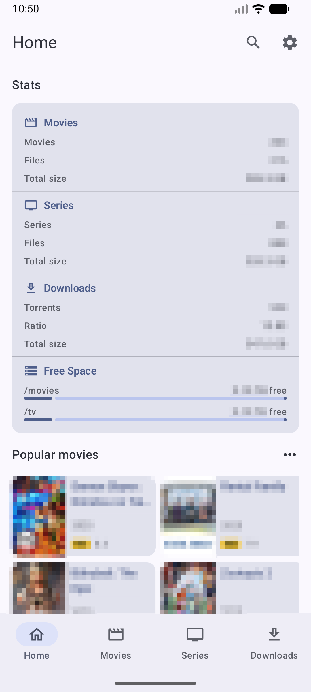
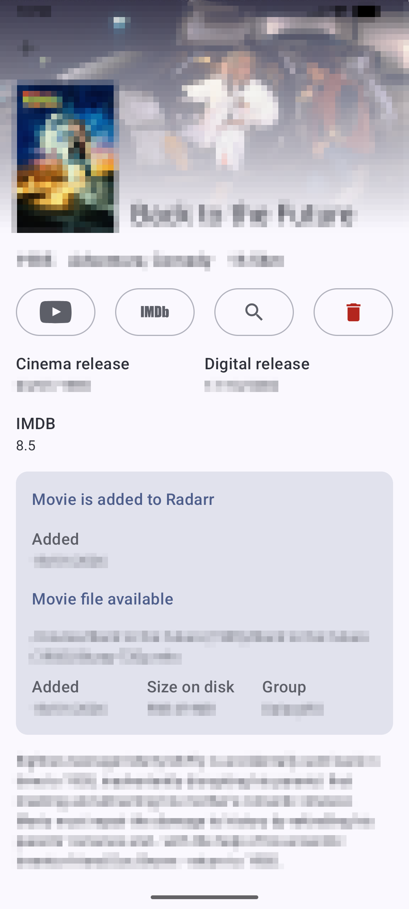
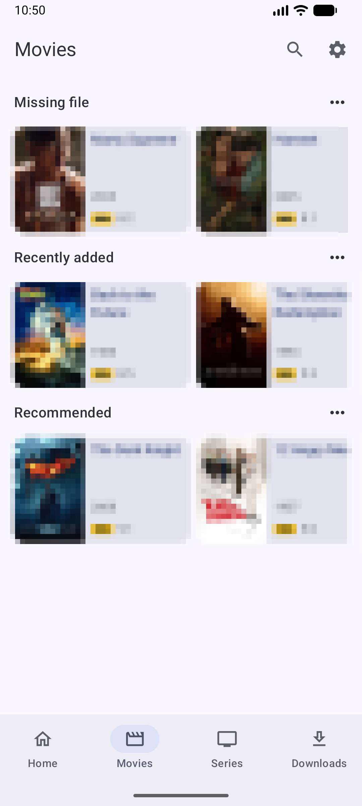
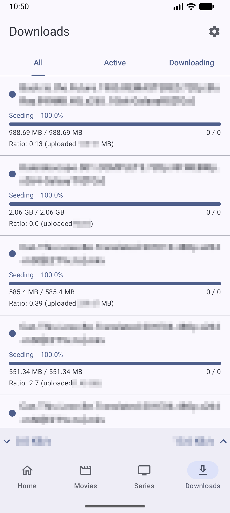
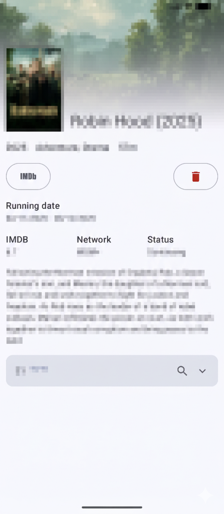

# Deckarr

Deckarr is a modern Android app built with Kotlin Multiplatform and Jetpack Compose. For now,
it has only Android implementation, but we hope to add more platforms in the future.
It provides a seamless experience for managing and discovering movies, series, and downloads.

## Screenshots

    

## Features

- Browse and search for movies and series
- Manage downloads
- Material 3 UI with Jetpack Compose
- Fast and lightweight

## Getting Started

### Prerequisites

- Android Studio (latest version recommended)
- Android SDK 36 or higher
- JDK 21 or higher

### TMDB API Key Setup

Deckarr uses the [TMDB API](https://www.themoviedb.org/settings/api) to fetch Popular and Trending
series.

1. Create a free account on [TMDB](https://www.themoviedb.org/) and open **Settings → API**.
2. Copy your **API Read Access Token** (the long Bearer token — not the short API Key).
3. Create a `secrets.properties` file in the project root directory (next to `settings.gradle.kts`):

```properties
tmdb.accessToken=YOUR_TMDB_READ_ACCESS_TOKEN
```

4. Sync Gradle and build the project.

> `secrets.properties` is listed in `.gitignore` and will not be committed to Git. The app still
> compiles without this file, but Popular and Trending series will not load.

### Building the APK

To build the release APK locally:

```bash
./gradlew :androidApp:assembleRelease
```

### Installing the APK

1. Copy the APK to your Android device.
2. Enable "Install from unknown sources" in your device settings.
3. Tap the APK file to install.

## Downloading Releases

You can download the latest APK from this repo.

## Contributing

Contributions are welcome! Please open issues or submit pull requests for improvements and bug
fixes.

## License

This project is licensed under the GPL-3.0 License. See the [LICENSE](LICENSE) file for details.

## Contact

For questions or support, [mail me](mailto:iregados1@gmail.com).
